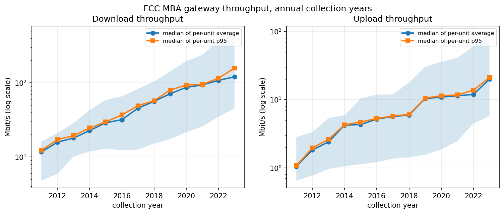
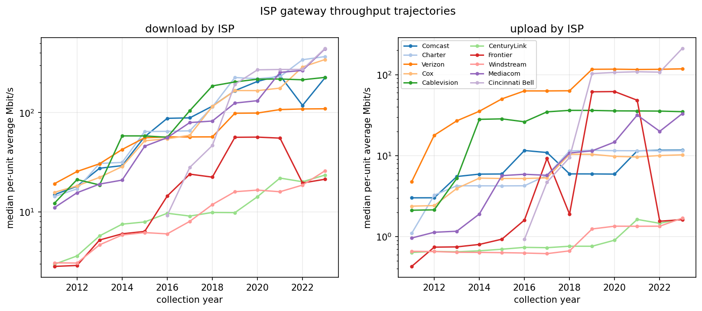
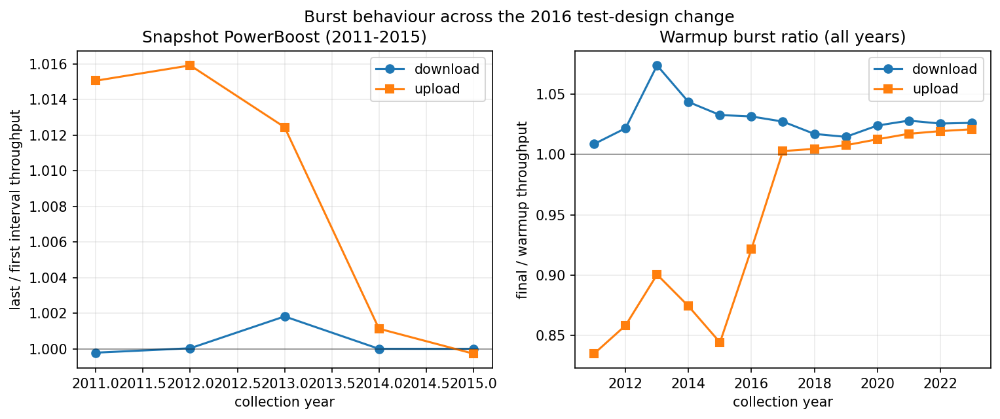
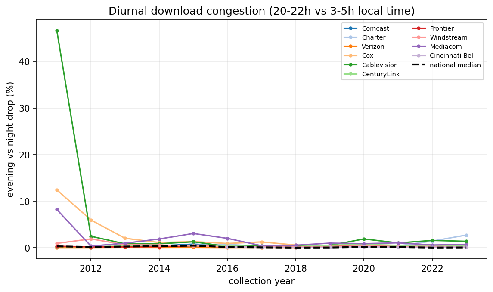
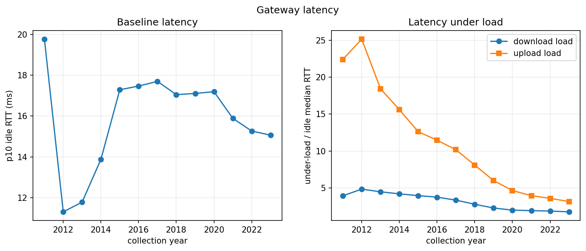
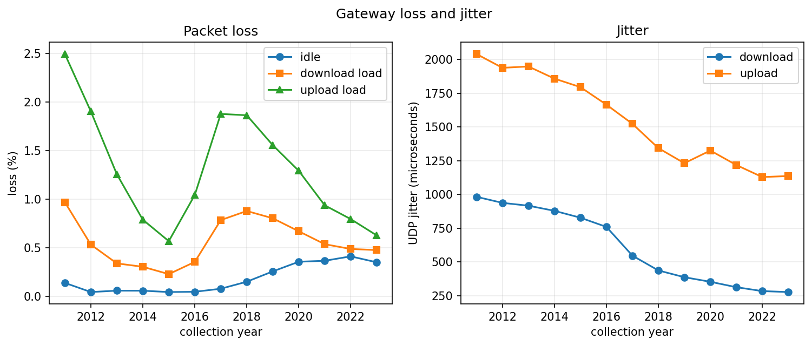
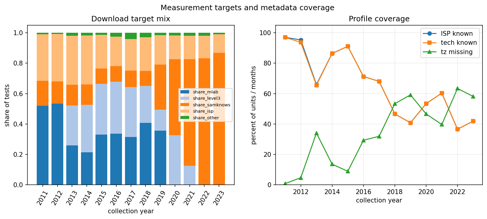
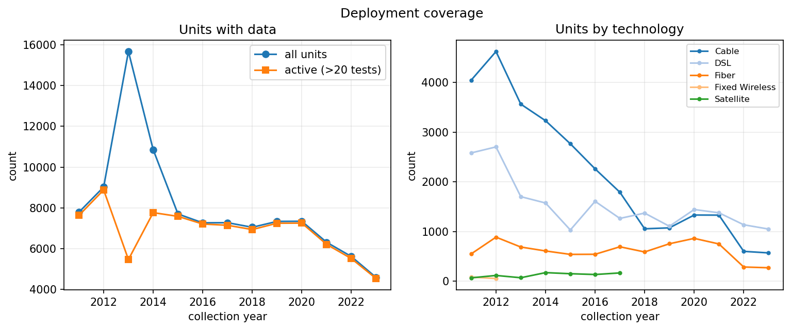

# Multi-year FCC MBA gateway trends (2011-2023)

This report extends the 2011 SIGCOMM gateway reproduction to all available FCC Measuring Broadband America raw months. The unit of analysis is the gateway measurement: active throughput, idle and under-load latency, loss, jitter, and diurnal throughput. All available raw tarballs are streamed directly from the `mba-data` object store; no raw data are stored in the repository.

## Data and method

- Collection years: 2011-2023; 140 processed year-month files.

- Per-unit monthly metrics are computed from `curr_httpgetmt`, `curr_httppostmt`, `curr_ping`, `curr_dlping`, `curr_ulping`, and `curr_udpjitter`.

- Throughput is final `bytes_sec`; PowerBoost is the last over the first 5-second interval for 2011-2015. From 2016 each test is single-shot, so a warmup burst ratio (final / warmup throughput) is reported instead.

- Under-load latency ratios use average RTT during download/upload probes divided by idle average RTT.

- Local time uses the FCC profile timezone offsets, with US DST applied; diurnal swing compares 20:00-22:00 with 03:00-05:00 local time.

- Target classes are M-Lab, Level3, SamKnows, ISP-hosted, and other. The mix changes sharply across years, so absolute throughput is not a clean cross-era comparison; normalized and within-unit metrics are the main trend evidence.

## Key results

- Median unit-month average download grew from 11.7 Mbit/s in 2011 to 120.7 Mbit/s in 2023.

- Median unit-month average upload grew from 1.0 to 20.0 Mbit/s over the same period.

- Median unit-month diurnal download drop fell from 0.3% to 0.0%.

- Median per-unit p10 baseline idle RTT moved from 19.8 ms to 15.1 ms; median download under-load ratio from 3.9x to 1.8x.

- Median UDP jitter (sparse in 2011, broadly available from 2012) is 277 microseconds downstream in 2023.

## Figures

## Caveats

- Data availability: 2023-03 contains no gateway test members; 2016-07 lacks upload under-load probes; 2020-01 lacks download and upload under-load probes. A small number of malformed multi-target rows in 2021-03 were skipped.

- The 2011 paper's exact Dec 2010-Jan 2011 window is not in the archive; the trend uses available collection months.

- The 2016 test redesign removes the six-snapshot PowerBoost; the warmup burst ratio is not identical.

- ISP/technology labels come from each year's FCC profile. Units absent from the profile are kept in national totals but excluded from ISP/technology splits; coverage is shown in Figure 7.

- Target hostnames change by year and hosting network. Absolute throughput levels partly reflect target changes.

- No traceroute/first-hop data are used; latency is gateway-to-target, not strictly last-mile.

## Files

- `output/trends/annual_national.csv`, `annual_isp.csv`, `annual_technology.csv`, `monthly_national.csv`, `target_mix.csv`, `coverage.csv`

- `output/trends/unit_month_metrics.parquet` (per-unit monthly metrics)
